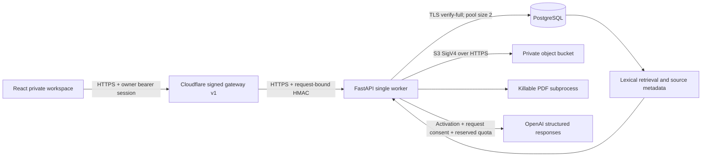

# Online MVP V1 architecture

## Repository audit before implementation — 2026-11-07

Base: `feature/signed-cloud-gateway`, `19ad79830595fd1ab13f4a0135f847e240e714f9`.
The initial workspace was on `feature/product-alignment-review`; the new branch
was created from the fetched deployment tip, preserving the original branch.

| Component | Existing behavior | Decision / dependency |
| --- | --- | --- |
| React/Vite | Memory-only bearer sessions, profile CRUD, PDF/base64 upload, consent and citations | Reuse; expose mode, conservative upload limits, deletion and evidence inspection |
| FastAPI | Host/origin/HTTPS checks, sanitized errors, JSON body bounds | Preserve all guards; separate explicit online configuration |
| SQLAlchemy | SQLite only; absolute file path assumed | Add psycopg PostgreSQL, bounded pool, explicit migrations and schema validation |
| Alembic 0001–0003 | Vessels, chunks, SQLite FTS triggers, sessions/rates/quotas | Retain SQLite schema; dialect-guard SQLite FTS migration; additive online migration |
| Authentication | One configured administrator, scrypt, hashed opaque sessions, CSRF for cookies | Retain single-owner login; scope every API read/write by authenticated owner; no public signup |
| Signed gateway | HMAC v1 binds method/host/path/query/body/auth/origin, timestamp and atomic replay nonce | Keep wire protocol and default 64 KiB disposable limit; separately opt into bounded online uploads |
| Render scripts | Disposable launcher creates isolated temporary DB and runs migrations; production launcher never migrates | Preserve disposable launcher; online uses production launcher after operator-run migration |
| Documents | pypdf, 10 MB/300 pages, local private UUID originals, SQLite FTS5/BM25 | Reuse extraction/chunking; online uses private S3 originals and isolated bounded PDF parsing |
| Retrieval | One document per question, up to six 1,600-character passages | Preserve offline FTS; PostgreSQL generated tsvector/GIN lexical index; no embedding service |
| OpenAI | Official SDK, structured output, explicit request consent, zero retries, exact quote validation | Reuse; online activation flag defaults off; durable usage/cost reporting |
| Quotas/security SQL | SQLite BEGIN IMMEDIATE, INSERT OR IGNORE, unqualified window in upsert | Port transactions/upserts to PostgreSQL without weakening atomicity |
| Tests/deployment | Pytest, Vitest, Playwright, gateway Node/TLS tests; existing examples target disposable mode | Run baseline and regressions; add PostgreSQL integration and provider mocks; leave live configuration untouched |

## Migration risks identified

PostgreSQL cannot execute FTS5 DDL or SQLite transaction statements. A database URL
change alone is unsafe. Existing file-backed originals do not migrate to object
storage automatically. Legacy rows have no owner; online access must fail closed
until an operator performs an audited import. Sessions, quotas and replay state
must be durable. Object storage and SQL have no shared transaction, requiring
recoverable states. Unbounded PDF parsing can exhaust a free instance. API keys
alone must not enable paid inference. The existing Worker configuration names the
live service; a separate example must avoid accidental deployment to that name.

Implementation and validation details are appended below after execution.

## Implemented architecture

`MARITIME_ONLINE_MVP_MODE=true` selects the online profile. It requires production
security, bearer sessions, signed-gateway transport, certificate-verified
PostgreSQL and private S3 configuration with a persistence acknowledgement.
Invalid/missing online settings fail closed. There is no SQLite or local-file
fallback in online mode. Provider construction makes no inference calls.
`MARITIME_AI_ENABLED=false` is the default; a key alone never activates online AI.
Disposable mode retains the exact synthetic fixture, temporary isolated SQLite,
blocked profile writes and blocked inference. Existing offline/legacy local
configuration remains supported independently.

### Database and identity

SQLAlchemy normalizes PostgreSQL URLs to psycopg. Runtime pools have two
connections and no overflow, five-second checkout/connect limits, pre-ping and
five-minute recycling; prepared statements are disabled for pooler compatibility.
Queries have 10-second statement / five-second lock timeouts on direct/session
connections. Use one application worker and one replica. Supabase session pooling
is preferred when direct IPv6 is unsuitable; this footprint does not require a
separate paid pooling service. Transaction poolers require role-level timeouts
and provider-specific validation before use.

Alembic 0001–0003 preserve SQLite data; 0002's SQLite FTS DDL is now dialect-guarded
so a fresh PostgreSQL database can traverse the same history. Additive 0004 adds
owner IDs, document lifecycle/checksum/size/page count, actual usage counters and
a PostgreSQL generated `tsvector` plus GIN index. PostgreSQL application tables
and Alembic metadata enable RLS and revoke PUBLIC/anon/authenticated access.
Provision a backend-only role/policy before deployment. No app startup performs
migrations. Downgrades are permitted only for empty disposable databases;
populated data requires a matching verified backup and application rollback.

Existing scrypt/opaque-session authentication is preserved. This release has
**one configured administrator, no signup or multi-user account management**.
New profile and document rows carry that authenticated identity; every library,
profile, original, search, excerpt, question and delete route scopes ownership.
Another owner's IDs yield 404. Gateway proofs never supply user identity.
Legacy unowned rows remain available to the original offline workspace, but
online startup refuses them rather than assigning ownership implicitly.

### Documents and recovery

`DocumentStorage` has local and S3 implementations. Local UUID `.bin` originals
remain compatible with existing backup/offline workflows. S3 uses explicit
backend credentials, SigV4, HTTPS, bounded timeouts, one network attempt and no
public ACL or public URLs. Only metadata and extracted text enter PostgreSQL.
Online originals are never persisted on Render's filesystem.

Upload is JSON/base64 to preserve the existing JSON/origin boundary. Online
limits: 3,000,000 original bytes, 4,100,000 request bytes, 50 pages, 200,000
extracted characters, 20 seconds wall time, one active upload/delete, three
upload attempts per minute by default, 20 records per owner and 100 total.
Pending/deleting records count toward storage quota. The parser runs in a child
without cloud credential environment variables; Linux caps address space at
256 MiB and CPU at 15 seconds. Scanned/encrypted/malformed PDFs are rejected;
no OCR, external processing service or model download is introduced.

1. Validate and extract before persistence.
2. Commit a `pending` row with generated object key, owner, SHA-256 and metadata.
3. PUT the original, then transactionally insert page chunks and mark `ready`.
4. An interrupted/ambiguous PUT or indexing failure leaves a tracked `pending`
   record. It cannot answer questions. Delete it and re-upload after recovery.
5. Deletion commits `deleting`, removes the object idempotently, then removes
   chunks and metadata in SQL. Failed deletes remain visible for retry.
6. Startup checks schema, connection, bucket access and ready-original sizes;
   downloading an original verifies SHA-256. It refuses missing storage.

Upload and delete share a process semaphore to prevent a second tab deleting an
in-flight pending record. A hard restart releases the slot and leaves its durable
record available for cleanup. This is recovery by explicit deletion/re-upload,
not resumable byte transfer. No timer silently deletes documents.

### Retrieval and inference

SQLite retains FTS5/BM25 and Unicode normalization. PostgreSQL uses the built-in
`simple` text-search configuration and GIN ranking, with each term parsed through
bound `plainto_tsquery` parameters and OR-combined. These are lexical engines;
no semantic-embedding equivalence or Vietnamese recall parity is claimed.
The API supports local search and full excerpt inspection without OpenAI.

Questions remain scoped to one selected document. With per-request consent,
OpenAI translates English/Vietnamese search terms, retrieval supplies at most
six 1,600-character chunks, and structured completion returns claims with exact
quotes and excerpt IDs. The server constructs document/page references, rejects
unknown IDs and mismatched quotes, and returns a no-evidence message or decline
when appropriate. Prompts require conflicting positions to be cited separately;
there is no automatic authority resolver or cross-document synthesis.

A durable conditional quota update reserves both maximum inputs and outputs
before creating a provider. Rate/concurrency/storage failures block inference;
failures never refund reservations. Retry policy remains explicitly zero,
avoiding duplicate charges on ambiguous failures. SDK usage is recorded per
call, including parsed refusals where usage exists; missing online usage or a
ledger failure withholds the answer. Cost reporting uses configured prices for
one allowed model. Unknown failed-call usage is flagged and covered by the full
reservation rather than treated as zero billing.

## Remaining limits

No actual Supabase/Render/Worker integration or paid inference was performed.
S3 behavior uses SDK stubs and a failing in-memory adapter in end-to-end backend
tests. The private-bucket acknowledgement cannot prove provider ACL settings;
an unauthenticated provider access test remains a deployment gate. No malware
scanner, OCR, semantic index, fleet selector, automated old-data migration,
provider billing integration, multi-replica coordination or independent maritime
answer-quality benchmark is included. This is an implemented and locally tested
foundation, not a production-readiness certification.

PostgreSQL computed search fields/indexes are migration-owned and excluded from
ORM autogeneration comparisons; owner indexes match model metadata. Alembic can
render the PostgreSQL upgrade SQL for offline review without connecting. The
local integration suite also checks that a browser-like role granted SELECT can
still see no document rows through RLS.
