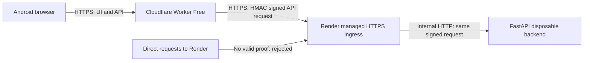

# Recommended $0 cloud architecture: authenticated HTTPS gateway

Date: 2026-11-06. Implementation branch: `feature/signed-cloud-gateway`, based
on deployed baseline `3932bad`. No provider resources or deployments were created.

## Recommendation and security boundary

Use **Cloudflare Workers Free for the frontend and signed API gateway**, and
retain **Render Free for the existing disposable Python backend**. Android users
open the Worker's `https://<worker>.<account>.workers.dev` URL. No personal
computer, purchased domain, database subscription or paid AI key is needed.

Render's managed TLS termination and HTTP forwarding are accepted from the
operator's independently verified official documentation. Its unverified
forwarded-header sanitization is **not** used. Docker changes packaging and local
networking; it would not authenticate Render's forwarded headers. No Docker
image or sidecar proxy is needed for this solution.

The Worker requires both an HTTPS `Request.url` and Cloudflare's read-only
`request.cf.tlsVersion` connection metadata (`TLSv1.2` or `TLSv1.3`). Missing or
older TLS metadata fails closed; a client header cannot populate this runtime
property. It never uses `X-Forwarded-Proto`. It sends requests only to the configured
HTTPS `*.onrender.com` origin with certificate verification and manual redirect
handling. It never follows redirects carrying credentials or signatures. Static
HTTP visits redirect to HTTPS before the login page is served.

The Worker signs a protocol version explicitly attesting HTTPS, timestamp,
random nonce, method, backend Host, encoded path/query, Authorization,
Content-Type, Origin, CSRF header and SHA-256 body digest with HMAC-SHA-256.
Caller-supplied proof/proxy headers and cookies are not forwarded. The shared
256-bit transport secret stays in provider secret stores and never in frontend
code, browser responses, URLs, Git, or logs.

Uvicorn proxy-header trust is **disabled**. The backend authenticates the MAC,
rejects duplicates/modified requests and expired proofs, atomically consumes the
nonce in its existing security-window table, then supplies the attested HTTPS
scheme to the unchanged HTTPS guard. Unsigned direct Render requests, including
health and preflight requests, fail closed. Host validation remains outermost.
Owner password login, memory-only bearer sessions, CORS/Origin checks and all
disposable/no-inference restrictions remain active. The transport credential
does not authenticate an owner or create a user session.

This adds a verifiable trust mechanism independent of proxy IPs: possession of
the server-side HMAC key plus the gateway's validated HTTPS request path. Both
providers remain trusted with application secrets, as managed hosting requires.
It is not an unconditional scheme override based on an environment flag.

## Official evidence actually retrieved

Cloudflare sources were retrieved from its official documentation repository at
immutable commit `122503ea9a75f037164741e76b2fea8cc5316774`:

| Source | Evidence used |
| --- | --- |
| [Request API][request] | Incoming Request is provided by the fetch handler; properties are read-only; `cf.tlsVersion` describes the connection's TLS version, independently of supplied HTTP headers; manual redirects prevent credential forwarding |
| [Web Crypto][crypto] and [signed-request example][signing] | Native HMAC/SHA-256 signing and verification are supported |
| [Secrets][secrets] | Per-Worker encrypted secret bindings; dashboard secret input; secret CLI commands may deploy immediately |
| [workers.dev][workersdev] | Provider subdomain without buying/onboarding a domain; intended for personal/hobby, noncritical applications |
| [Pricing][pricing] and [limits][limits] | Free: 100,000 Worker requests/day, 10 ms CPU/request, 128 MB/isolate; quota exhaustion can fail closed rather than incur paid-plan overage |
| [Static assets routing][assets] | Static assets binding and `run_worker_first` permit a same-origin UI and API gateway |

Render facts supplied and verified by the operator: [web services][render],
[private network][renderprivate], [Free][renderfree], and [tutorial][rendertutorial].
Direct re-fetches of Render docs remain blocked by this environment, so no new
claim about its IP ranges or sanitization is made. Its official GitHub FastAPI
example independently confirms binding to `0.0.0.0` and platform `PORT`.

## Cloud-only alternatives compared

| Architecture | Zero-cost evidence and restrictions | Existing backend fit / complexity | Decision |
| --- | --- | --- | --- |
| Render Free + Worker Free, signed gateway | User-selected Render $0 instance; verified Workers Free quotas; no paid bindings | Existing CPython/SQLite/scrypt code stays; one small gateway and shared secret | **Recommended** for this synthetic disposable test |
| Cloudflare Workers Free + D1 Free only | [D1 Free][d1] includes 5M rows read/day, 100k written/day, 5 GB; [quota exhaustion returns errors][d1faq] | Removes Render, but not a drop-in: [Python Workers][python] have isolate-local ephemeral files and nonfunctional threading. Current SQLAlchemy/SQLite FTS, session/rate state, locks and scrypt CPU must be ported/benchmarked against 10 ms CPU | Real $0 cloud candidate, substantially more application work; not selected |
| GitHub Codespaces included Free quota + HTTPS signed gateway | Official [billing source][codespaces] documents included personal Free quota and blocking at exhaustion without a valid payment method; [lifecycle][lifecycle] documents automatic stops. Account eligibility/remaining quota must be checked; paid usage must stay blocked | Real CPython cloud environment without a home PC, but finite monthly hours and manual restart/start management; unsuitable for unattended public availability | Disposable developer fallback only; not selected for minimal operations |
| Hugging Face Docker Space | Current [official overview][hf] requires a paid plan to create Docker compute Spaces, even though CPU Basic's hourly price is zero | Can run Python, but fails $0 subscription requirement | Excluded |

The recommendation avoids both a rewrite and VM/system administration. No home
server is proposed. A single-provider managed HTTPS deployment could also be
secure without forwarded-header trust if exclusive HTTPS ingress were verified;
the available Render evidence alone did not establish that complete invariant.
The signed gateway supplies the missing per-request authentication instead.

## Exact preparation and configuration

The instructions below are for a **later operator-controlled deployment**.
Do not run deploy/secret-upload commands during review. Disable Render automatic
deployments and previews before changing service branch/settings.

1. Register/use **Workers Free**, keep Render's existing **Free** instance, and
   select a workers.dev account subdomain. No custom domain is required.
   Determine the actual backend hostname and the intended Worker URL first.
2. Generate a transport secret locally in a private interactive terminal:
   `python -c "import secrets; print(secrets.token_hex(32))"`.
   Store the resulting 64 lowercase hex characters in your password manager.
   Generate the separate owner password hash with `python scripts/hash_password.py`.
   Do not use the all-zero interoperability-test credential.
3. In Render, later select `feature/signed-cloud-gateway`, repository root,
   Python 3, Singapore, **Free**, one instance. Keep Build Command:
   `python -m pip install -r backend/requirements-dev.lock && python -m pip install --no-deps -e backend`.
   Keep Start Command: `python scripts/start_disposable_test.py`.
4. Set Render environment values from
   [render-signed-gateway.env.example](../deploy/render-signed-gateway.env.example):

   | Variable | Exact value or owner-specific input |
   | --- | --- |
   | `MARITIME_ENV` | `production` |
   | `MARITIME_HTTPS_TRANSPORT` | `signed-gateway` |
   | `MARITIME_GATEWAY_SECRET` | Secret generated in step 2 |
   | `MARITIME_DISPOSABLE_TEST_MODE` | `true` |
   | `MARITIME_DISPOSABLE_ACK` | `SYNTHETIC_ONLY_DATA_LOSS_NO_PAID_AI` |
   | `MARITIME_STORAGE_PERSISTENT` | `false` |
   | `MARITIME_AUTH_TRANSPORT` | `bearer` |
   | `MARITIME_ADMIN_USERNAME` | `admin`, or your chosen owner username |
   | `MARITIME_PASSWORD_HASH` | Complete locally generated scrypt line |
   | `OPENAI_API_KEY` | `DISABLED-DISPOSABLE-TEST` — never a real API key |
   | `MARITIME_TRUSTED_HOSTS` | Actual Render hostname only, without scheme/path/port |
   | `MARITIME_ALLOWED_ORIGINS` | Actual Worker origin, e.g. `https://maritime-ai-gateway.<account>.workers.dev`, no trailing slash |
   | `MARITIME_BIND_HOST` | `0.0.0.0` |
   | `WEB_CONCURRENCY` | `1` |

   **Delete `MARITIME_TRUSTED_PROXY_IPS`**; do not put a wildcard/range in it.
   Leave `PORT` platform-managed. Do not set disposable root/database/document
   paths; the launcher creates them. Other model/rate settings can retain their
   existing valid defaults; no inference can run in this profile.
5. Clear Render's HTTP Health Check Path and use its TCP health check. A direct
   unsigned HTTP health probe is deliberately rejected, not exempted from
   transport security. Confirm the service dashboard accepts the TCP/default
   setting before rollout; otherwise this is a rollout blocker.
6. In [gateway/wrangler.jsonc](../deploy/gateway/wrangler.jsonc), replace both
   origin placeholders with the actual HTTPS origins, keeping `name` consistent
   with the Worker URL. The backend origin must end in `.onrender.com`; the public
   origin must end in `.workers.dev`. No paths, credentials, custom ports or query.
7. Build the UI from `frontend`: `npm ci`, then
   `npm run build -- --base /`. Leave `VITE_API_BASE_URL` unset/empty; keep bearer
   transport. The root-base override is necessary because the existing default
   build targets `/Maritime-AI/`. Never place either backend secret in `VITE_*`.
8. From `deploy/gateway`, run `npm test`. Later, configure a Worker secret binding
   named `MARITIME_GATEWAY_SECRET` with the **same** secret as Render. Keep both
   origin variables as nonsecret configuration. Use a reviewed Wrangler release
   or dashboard upload, keeping the Workers **Free** plan and no paid bindings.
   **Secret upload may itself deploy a version**; do this only during the later
   authorized manual rollout. `wrangler deploy --dry-run` is for build inspection;
   no live deployment command has been run here. Bundle validation used Wrangler
   `4.158.0`; from this directory a repeatable inspection command is
   `npx --yes wrangler@4.158.0 deploy --dry-run` (after building the UI).
9. After both services are configured, manually deploy at your chosen time.
   Visit the Worker HTTPS URL on Android. Use that URL exclusively for the UI/API.

## Verification, limits and remaining rollout work

Local tests verify the Python/JavaScript protocol against an independent golden
vector, direct/forged header denial, changed signed fields/body/path/method/query,
duplicate headers, expiry, concurrent replay, fail-closed nonce storage, preserved
owner authentication and synthetic-only/no-AI restrictions. Cross-language testing
runs the actual Worker signer against Uvicorn and the production disposable app
over real TLS with an explicitly trusted test CA; certificate checking stays on.

These are code/cryptographic checks, not a live Cloudflare/Render certification.
Validation results: 151 backend tests (including the Node/Python TLS integration),
7 Worker tests, 25 frontend tests and all 5 Chromium browser cases passed. The
root-base frontend build, Wrangler 4.158.0 deployment **dry run**, Python dependency
check and changed-Python lint also passed. The actual disposable launcher was
started with signed-gateway mode and no trusted proxy IPs: signed health/login
succeeded and an unsigned scheme-spoofed request was rejected. The existing
GitHub frontend CI job now also runs the Worker tests. Remote CI was not claimed
as run; backend TLS integration skips if Node/OpenSSL/compiled gateway tooling
is unavailable.

Before rollout verify actual URLs, account Free eligibility, TCP health setting,
documented `cf.tlsVersion` availability on the actual workers.dev route,
Worker CPU usage within 10 ms for the tiny synthetic fixture, secret equality,
and cold-start behavior. The Worker limit is 64 KiB per API body; arbitrary
document uploads are not supported in this disposable profile. No unbounded
request buffering or paid storage service was added. Worker-first static visits
also count toward the daily request quota; choose fail-closed behavior if the
dashboard offers a failure-mode setting. Do not upgrade to a paid plan.

Render sleep/restarts still lose sessions/documents/rate state by design. Proofs
expire after 120 seconds to accommodate normal wake-up delays (at most 5 seconds
future skew). Longer wake-ups can still require a retry. Replay records reset on
disposable restart, so a stolen still-valid proof could be replayed after a reset.
Proofs are never delivered to browser clients; both network hops use managed
HTTPS. Keep request/header debug logging off. Owner authentication remains
mandatory independently. A leaked gateway key requires rotation on both services.

The gateway does not attest a browser IP. Login limits use Uvicorn's immediate
peer and the existing global counter, which can be coarser/more restrictive than
per-browser limits. No client-supplied IP header can weaken them. No Windows,
physical Android, public-TLS issuance or live-cloud performance claim is made.

[request]: https://github.com/cloudflare/cloudflare-docs/blob/122503ea9a75f037164741e76b2fea8cc5316774/src/content/docs/workers/runtime-apis/request.mdx
[crypto]: https://github.com/cloudflare/cloudflare-docs/blob/122503ea9a75f037164741e76b2fea8cc5316774/src/content/docs/workers/runtime-apis/web-crypto.mdx
[signing]: https://github.com/cloudflare/cloudflare-docs/blob/122503ea9a75f037164741e76b2fea8cc5316774/src/content/docs/workers/examples/signing-requests.mdx
[secrets]: https://github.com/cloudflare/cloudflare-docs/blob/122503ea9a75f037164741e76b2fea8cc5316774/src/content/docs/workers/configuration/secrets.mdx
[workersdev]: https://github.com/cloudflare/cloudflare-docs/blob/122503ea9a75f037164741e76b2fea8cc5316774/src/content/docs/workers/configuration/routing/workers-dev.mdx
[pricing]: https://github.com/cloudflare/cloudflare-docs/blob/122503ea9a75f037164741e76b2fea8cc5316774/src/content/docs/workers/platform/pricing.mdx
[limits]: https://github.com/cloudflare/cloudflare-docs/blob/122503ea9a75f037164741e76b2fea8cc5316774/src/content/docs/workers/platform/limits.mdx
[assets]: https://github.com/cloudflare/cloudflare-docs/blob/122503ea9a75f037164741e76b2fea8cc5316774/src/content/docs/workers/static-assets/routing/worker-script.mdx
[d1]: https://github.com/cloudflare/cloudflare-docs/blob/122503ea9a75f037164741e76b2fea8cc5316774/src/content/partials/workers/d1-pricing.mdx
[d1faq]: https://github.com/cloudflare/cloudflare-docs/blob/122503ea9a75f037164741e76b2fea8cc5316774/src/content/partials/d1/faq-pricing.mdx
[python]: https://github.com/cloudflare/cloudflare-docs/blob/122503ea9a75f037164741e76b2fea8cc5316774/src/content/docs/workers/languages/python/stdlib.mdx
[codespaces]: https://github.com/github/docs/blob/58b7b56aa507ad1269b9f8e9e89a172f0976c7ce/content/billing/concepts/product-billing/github-codespaces.md
[lifecycle]: https://github.com/github/docs/blob/58b7b56aa507ad1269b9f8e9e89a172f0976c7ce/content/codespaces/about-codespaces/understanding-the-codespace-lifecycle.md
[hf]: https://github.com/huggingface/hub-docs/blob/1fd5a44a569a080fbdf2bb7ef244be1b64e4414f/docs/hub/spaces-overview.md
[render]: https://render.com/docs/web-services
[renderprivate]: https://render.com/docs/private-network
[renderfree]: https://render.com/docs/free
[rendertutorial]: https://render.com/tutorials/web-service-vs-static-site/web-services
